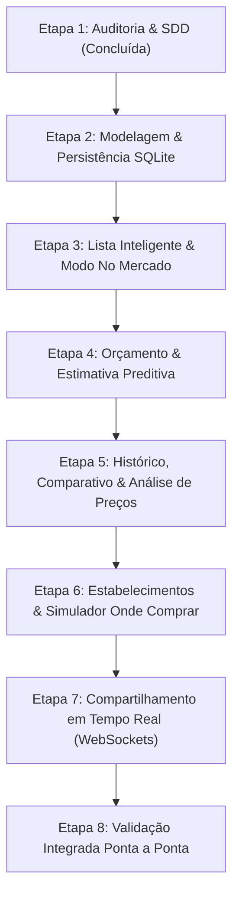

# ESPECIFICAÇÃO TÉCNICA E ARQUITETURA SDD — LISTA DE COMPRAS INTELIGENTE (FEIRA)

**Documento:** Especificação Técnica de Requisitos, Modelagem e Arquitetura (Etapa 1)  
**Projeto:** Feira — Plataforma Inteligente de Gestão de Compras e Orçamento  
**Metodologia:** SDD (Specification-Driven Development) + RISEN + Prompt Chaining  
**Ambiente:** Localhost / Offline / Rede Local Privada (100% Gratuito & Open-Source)  
**Data:** 28/10/2026  

---

## 1. DIAGNÓSTICO DA ARQUITETURA E AMBIENTE ATUAL

### 1.1. Inspeção do Ambiente e Infraestrutura
- **Sistema Operacional:** Windows (ambiente do usuário).
- **Runtime:** Node.js v24.22.1 LTS.
- **Gerenciador de Pacotes:** npm 11.19.1 (execução via `npm.cmd` garantindo compatibilidade irrestrita com políticas de execução do Windows PowerShell).
- **Controle de Versão:** Git 2.54.0 (isolado localmente, estritamente sem push para repositórios remotos).
- **Módulo Nativo de Banco de Dados:** Node.js v24 possui `node:sqlite` nativo (`DatabaseSync`), permitindo banco de dados relacional SQLite 3.53.4 com transações ACID, modo WAL e altíssima performance, com **zero dependências nativas binárias ou compilações gyp**.
- **Estado Inicial do Projeto:** Greenfield (projeto recém-iniciado). Contém na raiz `prompt-feira.md`, `.agents/rules/diretrizes.md` e `MAPA_DO_PROJETO.md`.

### 1.2. Diretrizes Invioláveis de Governança
1. **Autonomia Operacional:** O usuário concedeu autorização expressa em `.agents/rules/diretrizes.md` para execução autônoma das etapas sem interrupções triviais.
2. **100% Gratuito & Open Source:** Proibição de serviços de nuvem pagos, bancos gerenciados ou APIs pagas.
3. **Prontidão para Nuvem e Escala Online:** Desenvolvido localmente para prototipagem ágil, mas concebido arquiteturalmente para operar online em produção, com múltiplos usuários, suporte a contêineres Docker, variáveis de ambiente e banco de dados centralizado.
4. **Governança do Mapa:** Todo arquivo criado ou modificado deve ser imediatamente documentado em `MAPA_DO_PROJETO.md`.

---

## 2. ESPECIFICAÇÃO DE MÓDULOS E REGRAS DE NEGÓCIO

### Módulo A — Lista de Compras Inteligente & Modo "No Mercado"
1. **Setorização Automática:**
   - Classificação nativa em setores: *Hortifrúti*, *Açougue & Peixaria*, *Laticínios & Frios*, *Grãos, Massas & Mercearia*, *Padaria & Sobremesas*, *Bebidas*, *Limpeza & Lavanderia*, *Higiene & Cuidados*, *Outros*.
   - Associação automática com base em dicionário de palavras-chave inteligentes (ex: "tomate" $\rightarrow$ Hortifrúti, "detergente" $\rightarrow$ Limpeza).
   - Edição manual permitida a qualquer instante, persistindo a escolha do usuário como prioridade sobre a heurística.
2. **Modo "No Mercado" (Experiência Mobile One-Hand):**
   - Layout ultra-simplificado focado em usabilidade com uma mão:
     - Botões táteis com área de toque mínima de $48 \times 48\text{ px}$.
     - 1 toque no card marca o item como comprado e atualiza o subtotais instantaneamente.
     - Ocultação suave automática dos itens comprados para manter na tela apenas o que resta comprar.
     - Botão de alternância flutuante: "Ver comprados (X itens)" para conferência rápida.
     - Indicador fixo inferior de progresso da feira: Total Gasto até agora vs Orçamento.
3. **Gestão de Itens e Listas:**
   - CRUD completo de produtos na lista (nome, quantidade, unidade, estimativa de preço, preço real pago, categoria, observações).
   - Favoritar produtos para acesso em 1 clique.
   - Duplicação de listas inteiras com opção de limpar preços para nova feira.
4. **Compartilhamento em Tempo Real:**
   - Criação de listas com código de compartilhamento local (ex: PIN ou ID legível).
   - Sincronização bidirecional via WebSocket local: quando a pessoa A no corredor de hortifrúti marca "Maçã", o celular da pessoa B no corredor de limpeza atualiza na mesma fração de segundo sem reload.
   - Controle de permissões: Proprietário (`admin`) e Participante (`write` ou `read`).

### Módulo B — Histórico e Comparativo de Feiras
1. **Fechamento e Congelamento da Feira:**
   - Ao concluir a feira, o sistema arquiva um snapshot imutável: data, estabelecimento principal, itens comprados, quantidades, preços unitários e totais.
2. **Comparativo Inteligente entre Feiras:**
   - Cálculo de $\Delta$ absoluto e percentual:
     $$\Delta_{\text{valor}} = \text{Total}_{\text{atual}} - \text{Total}_{\text{anterior}}$$
     $$\Delta\% = \left(\frac{\text{Total}_{\text{atual}} - \text{Total}_{\text{anterior}}}{\text{Total}_{\text{anterior}}}\right) \times 100$$
   - Mensagem clara e humanizada: *"Sua feira ficou R$ 42,00 mais cara (+6,8%)"*.
3. **Detecção de Maiores Variações:**
   - Lista os 3 produtos com maior aumento percentual/absoluto e os 3 produtos com maior redução.
4. **Gráfico Mensal de Cesta Básica / Produtos Essenciais:**
   - Rastreamento histórico de itens fundamentais (Arroz, Feijão, Café, Óleo, Leite, etc.) exibindo linha do tempo de preços pagos mês a mês.
5. **Comparação de Unidades Equivalentes:**
   - Conversor e normalizador matemático de unidades:
     - $1\text{ kg} = 1000\text{ g}$
     - $1\text{ L} = 1000\text{ ml}$
   - Exemplo de cálculo:
     - Pacote A: $1\text{ kg}$ por R$ 6,50 $\rightarrow$ Preço por kg = **R$ 6,50/kg**
     - Pacote B: $5\text{ kg}$ por R$ 31,00 $\rightarrow$ Preço por kg = **R$ 6,20/kg**
     - Sistema indica: *"O pacote de 5 kg é 4,6% mais econômico por kg"*.
6. **Integridade de Dados Históricos:**
   - Quando não houver feira anterior comparável, o sistema explicitamente declara: *"Histórico insuficiente para comparativo. Realize mais compras para habilitar estatísticas completas."* Zero números inventados.

### Módulo C — Cadastro Rápido e Reutilização
1. **Catálogo de Favoritos:**
   - Produtos marcados como favoritos ficam acessíveis em carrossel de chips na tela de adicionar itens.
2. **Clonagem e Templates:**
   - Botão *"Repetir feira anterior"*: cria nova lista mantendo produtos e quantidades costumeiras, zerando os status de comprado e preservando os preços anteriores apenas como referência de estimativa.
3. **Agilidade no Celular:**
   - Adição inline com teclado numérico configurado (`inputmode="decimal"`).
   - Suporte a seleção rápida de unidades padrão: `un`, `kg`, `g`, `L`, `ml`, `pct`, `cx`, `dz`.

### Módulo D — Orçamento e Estimativas
1. **Definição de Teto de Gastos:**
   - Campo para fixar orçamento máximo da feira (ex: R$ 500,00).
2. **Painel Visual Orçamentário em Tempo Real:**
   - Barra de progresso com transição de cor:
     - Verde: $0\% \le \text{Gasto} < 80\%$
     - Amarelo: $80\% \le \text{Gasto} \le 100\%$
     - Vermelho pulsante: $\text{Gasto} > 100\%$ (com aviso de limite ultrapassado em R$ X).
   - Métricas em destaque: Orçamento | Gasto Registrado | Saldo Restante.
3. **Estimativa Preditiva Baseada em Histórico:**
   - A estimativa da lista calcula a soma dos últimos preços pagos pelo usuário para cada item:
     $$\text{Estimativa Total} = \sum_{i=1}^{N} \left(\text{Quantidade}_i \times \text{Último Preço Histórico}_i\right)$$
   - Transparência total:
     - Exibe quantos itens possuem preço histórico (ex: "Estimativa baseada em 18 de 20 itens").
     - Identifica produtos sem preço prévio conhecido como "Preço a conferir".
     - Se o usuário for novo e não possuir compras anteriores, o bloco de estimativa histórica permanece oculto.
   - Diferenciação inequívoca na interface: **Valor Estimado** (previsto) vs **Valor Registrado** (carrinho) vs **Valor Efetivo** (finalizado).

### Módulo E — Comparação entre Estabelecimentos & Simulador "Onde Comprar"
1. **Associação por Estabelecimento:**
   - Registro de onde o produto foi adquirido (ex: "Supermercado Dia", "Atacadão", "Sacolão da Esquina", "Carrefour").
2. **Matriz de Cotações Locais:**
   - Tabela histórica armazenando `(produto_id, store_id, preco_normalizado, data)`.
3. **Simulador "Onde Comprar":**
   - Dada a lista de compras atual, o simulador projeta o custo total da lista em cada supermercado com base nos últimos preços cadastrados naquele local.
   - Apresenta:
     - Valor estimado no Estabelecimento A vs B vs C.
     - Economia potencial absoluta em Reais.
     - Alerta de itens sem preço naquele estabelecimento (ex: *"Supermercado Dia: 14/15 itens precificados"*).
   - Proibição de afirmar "Supermercado mais barato" caso a cobertura de produtos seja inferior a 80% ou haja defasagem temporal de mais de 90 dias, exibindo aviso de cotação parcial.

---

## 3. MODELAGEM DE DADOS E SCHEMA DO BANCO (SQLITE)

O banco de dados utilizará o módulo nativo `node:sqlite` do Node.js v24. Todos os valores monetários serão armazenados como **INTEGERS em centavos** (ex: R$ 12,50 = `1250`) para garantir precisão monetária absoluta sem erros de arredondamento de ponto flutuante.

```sql
PRAGMA foreign_keys = ON;
PRAGMA journal_mode = WAL;

-- 1. Usuários do sistema local
CREATE TABLE IF NOT EXISTS users (
    id TEXT PRIMARY KEY,
    name TEXT NOT NULL,
    pin_hash TEXT,
    avatar_color TEXT DEFAULT '#10B981',
    created_at DATETIME DEFAULT CURRENT_TIMESTAMP
);

-- 2. Categorias / Setores da feira
CREATE TABLE IF NOT EXISTS categories (
    id TEXT PRIMARY KEY,
    name TEXT NOT NULL UNIQUE,
    icon TEXT NOT NULL,
    color TEXT NOT NULL,
    display_order INTEGER NOT NULL DEFAULT 0,
    is_default INTEGER DEFAULT 1
);

-- 3. Estabelecimentos comerciais (Supermercados, feiras, atacadistas)
CREATE TABLE IF NOT EXISTS stores (
    id TEXT PRIMARY KEY,
    name TEXT NOT NULL UNIQUE,
    address_notes TEXT,
    created_at DATETIME DEFAULT CURRENT_TIMESTAMP
);

-- 4. Catálogo mestre de produtos
CREATE TABLE IF NOT EXISTS products (
    id TEXT PRIMARY KEY,
    name TEXT NOT NULL COLLATE NOCASE,
    category_id TEXT NOT NULL REFERENCES categories(id) ON DELETE RESTRICT,
    default_unit TEXT DEFAULT 'un',
    is_favorite INTEGER DEFAULT 0,
    created_at DATETIME DEFAULT CURRENT_TIMESTAMP,
    updated_at DATETIME DEFAULT CURRENT_TIMESTAMP
);

-- 5. Listas de compras
CREATE TABLE IF NOT EXISTS shopping_lists (
    id TEXT PRIMARY KEY,
    title TEXT NOT NULL,
    owner_id TEXT NOT NULL REFERENCES users(id) ON DELETE CASCADE,
    store_id TEXT REFERENCES stores(id) ON DELETE SET NULL,
    budget_cents INTEGER DEFAULT 0,
    status TEXT CHECK(status IN ('active', 'completed', 'archived')) DEFAULT 'active',
    share_code TEXT UNIQUE,
    created_at DATETIME DEFAULT CURRENT_TIMESTAMP,
    updated_at DATETIME DEFAULT CURRENT_TIMESTAMP,
    completed_at DATETIME
);

-- 6. Permissões de compartilhamento de listas
CREATE TABLE IF NOT EXISTS list_shares (
    id TEXT PRIMARY KEY,
    list_id TEXT NOT NULL REFERENCES shopping_lists(id) ON DELETE CASCADE,
    user_id TEXT NOT NULL REFERENCES users(id) ON DELETE CASCADE,
    permission TEXT CHECK(permission IN ('read', 'write', 'admin')) DEFAULT 'write',
    created_at DATETIME DEFAULT CURRENT_TIMESTAMP,
    UNIQUE(list_id, user_id)
);

-- 7. Itens dentro da lista de compras
CREATE TABLE IF NOT EXISTS list_items (
    id TEXT PRIMARY KEY,
    list_id TEXT NOT NULL REFERENCES shopping_lists(id) ON DELETE CASCADE,
    product_id TEXT NOT NULL REFERENCES products(id) ON DELETE RESTRICT,
    custom_name TEXT,
    category_id TEXT NOT NULL REFERENCES categories(id) ON DELETE RESTRICT,
    quantity REAL NOT NULL DEFAULT 1.0,
    unit TEXT NOT NULL DEFAULT 'un',
    estimated_price_cents INTEGER DEFAULT 0,
    actual_price_cents INTEGER DEFAULT 0,
    store_id TEXT REFERENCES stores(id) ON DELETE SET NULL,
    is_purchased INTEGER DEFAULT 0,
    purchased_at DATETIME,
    purchased_by_user_id TEXT REFERENCES users(id) ON DELETE SET NULL,
    sort_order INTEGER DEFAULT 0,
    notes TEXT,
    created_at DATETIME DEFAULT CURRENT_TIMESTAMP,
    updated_at DATETIME DEFAULT CURRENT_TIMESTAMP
);

-- 8. Histórico congelado de feiras finalizadas
CREATE TABLE IF NOT EXISTS purchase_history (
    id TEXT PRIMARY KEY,
    list_id TEXT NOT NULL REFERENCES shopping_lists(id) ON DELETE RESTRICT,
    store_id TEXT REFERENCES stores(id) ON DELETE SET NULL,
    total_spent_cents INTEGER NOT NULL DEFAULT 0,
    total_items INTEGER NOT NULL DEFAULT 0,
    budget_at_time_cents INTEGER DEFAULT 0,
    completed_at DATETIME DEFAULT CURRENT_TIMESTAMP,
    notes TEXT
);

-- 9. Histórico analítico de preços por produto e mercado
CREATE TABLE IF NOT EXISTS price_history (
    id TEXT PRIMARY KEY,
    product_id TEXT NOT NULL REFERENCES products(id) ON DELETE CASCADE,
    store_id TEXT NOT NULL REFERENCES stores(id) ON DELETE CASCADE,
    list_id TEXT REFERENCES shopping_lists(id) ON DELETE SET NULL,
    price_cents INTEGER NOT NULL,
    quantity REAL NOT NULL,
    unit TEXT NOT NULL,
    normalized_price_per_base_unit_cents INTEGER NOT NULL, -- em centavos por kg, litro ou un
    recorded_at DATETIME DEFAULT CURRENT_TIMESTAMP
);

-- Índices estratégicos para consultas rápidas
CREATE INDEX IF NOT EXISTS idx_products_name ON products(name);
CREATE INDEX IF NOT EXISTS idx_list_items_list ON list_items(list_id);
CREATE INDEX IF NOT EXISTS idx_list_items_purchased ON list_items(list_id, is_purchased);
CREATE INDEX IF NOT EXISTS idx_price_history_lookup ON price_history(product_id, store_id, recorded_at);
CREATE INDEX IF NOT EXISTS idx_purchase_history_completed ON purchase_history(completed_at);
```

---

## 4. ARQUITETURA DE SINCRONIZAÇÃO EM TEMPO REAL E SEGURANÇA LOCAL

### 4.1. Comunicação em Tempo Real (WebSocket Local)
- O servidor Node.js criará uma instância `WebSocketServer` via biblioteca padrão `ws` acoplada ao servidor HTTP Express na mesma porta (ex: `http://localhost:3000` e `ws://localhost:3000`).
- **Topologia de Salas (Rooms):**
  - Cada lista ativa possui uma sala no WebSocket identificada por `list:{list_id}`.
  - Ao entrar na tela da lista, o cliente se conecta e emite `{ type: 'JOIN_LIST', listId, userId }`.
  - Eventos transmitidos:
    - `ITEM_TOGGLED`: `{ itemId, isPurchased, actualPriceCents, purchasedBy }`
    - `ITEM_ADDED`: `{ item }`
    - `ITEM_UPDATED`: `{ itemId, updates }`
    - `ITEM_DELETED`: `{ itemId }`
    - `BUDGET_CHANGED`: `{ newBudgetCents }`
- **Tolerância a Falhas e Reconexão:**
  - Reconexão exponencial no cliente (`reconnectInterval`).
  - Em caso de queda momentânea de Wi-Fi, as ações locais são refletidas na UI com estado otimista e sincronizadas ao restabelecer a conexão.

### 4.2. Segurança e Controle de Acesso Local
- Autenticação local simplificada sem dependência de nuvem:
  - Sistema de perfis locais (ex: "Helena", "Família", "Convidado").
  - Identificação por token de sessão local assinado criptograficamente (`node:crypto` HMAC SHA-256).
  - Validação estrita de autorização em todos os endpoints REST e no handshake WebSocket: usuários sem autorização na lista têm suas requisições rejeitadas com HTTP 403.

---

## 5. DESIGN SYSTEM, UX/UI E RESPONSIVIDADE

### 5.1. Padrões Mobile-First
- **Tamanho de Toque:** Elementos interativos com altura mínima de `48px` e margem de segurança para evitar cliques acidentais.
- **Teclado Amigável:** Inputs configurados com `type="number"` ou `inputmode="decimal"` para acionar automaticamente o teclado numérico no smartphone.
- **Transições Visuais:** Animações CSS limpas (fade/slide) para itens marcados como comprados desaparecendo suavemente para a seção de concluídos.
- **Paleta de Cores:**
  - Primária: Verde Esmeralda (`#10B981` / `#059669`) — transmite economia, frescor e equilíbrio financeiro.
  - Alerta Orçamentário: Amarelo Âmbar (`#F59E0B`) para $80\%-100\%$, Vermelho Coral (`#EF4444`) para estouro.
  - Fundo Neutro: Slate suave (`#F8FAFC` no light mode / `#0F172A` no dark mode).
  - Categorias: Cores semânticas consistentes para cada setor (Hortifrúti: Verde; Açougue: Vermelho; Laticínios: Azul; Limpeza: Ciano; etc.).

### 5.2. Padrões Desktop
- Layout responsivo adaptado com grid de colunas:
  - Coluna Esquerda: Lista de compras setorizada com filtros rápidos.
  - Coluna Direita: Painel orçamentário fixo, simulador "Onde Comprar" e comparativo histórico.

---

## 6. CRITÉRIOS DE ACEITAÇÃO E MATRIZ DE RISCOS

| Risco Identificado | Nível | Estratégia de Mitigação |
| :--- | :---: | :--- |
| Políticas de script do PowerShell bloqueando `npm.ps1` | Alto | Utilizar rigorosamente `npm.cmd` em todos os comandos no Windows. |
| Inconsistência de centavos em cálculos de moeda | Médio | Armazenamento exclusivamente em inteiros (centavos) no SQLite e formatação monetária segura via `Intl.NumberFormat('pt-BR')`. |
| Concorrência de escrita no SQLite durante feira simultânea | Baixo | Habilitar `PRAGMA journal_mode = WAL;` (Write-Ahead Logging) no SQLite nativo para permitir leituras concorrentes ilimitadas e escritas transacionais seguras. |
| Perda de conexão Wi-Fi dentro do mercado físico | Médio | Suporte a cache offline local no cliente (IndexedDB / LocalStorage) sincronizando transações pendentes ao reconectar. |

---

## 7. PLANO DE IMPLEMENTAÇÃO PRIORIZADO (ETAPAS 2 A 8)



1. **Etapa 2 — Modelagem e Persistência:**
   - Inicializar projeto monorepo/fullstack com Vite + React (frontend) e Node.js ES Modules (backend).
   - Implementar camada de dados SQLite com migrações automáticas, seeds de categorias e produtos essenciais.
   - Implementar suite de testes de integridade referencial e persistência.
2. **Etapa 3 — Lista Inteligente & Modo "No Mercado":**
   - Construir componentes da lista, setorização automática e CRUD.
   - Construir o Modo "No Mercado" mobile-first com botões ergonômicos e filtro de concluídos.
3. **Etapa 4 — Orçamento e Estimativas:**
   - Implementar cálculo dinâmico de orçamento, barra de progresso e alertas visuais.
   - Implementar algoritmo de estimativa preditiva com base em preços reais anteriores.
4. **Etapa 5 — Histórico e Análise de Preços:**
   - Implementar fechamento de feira e comparador delta ($\Delta$ valor e $\Delta\%$).
   - Implementar conversor de unidades equivalentes e gráfico mensal de itens essenciais.
5. **Etapa 6 — Estabelecimentos & Simulador:**
   - Cadastro e histórico segmentado por loja.
   - Implementação do simulador "Onde Comprar" com análise de economia potencial.
6. **Etapa 7 — Compartilhamento em Tempo Real:**
   - Servidor WebSocket local e sincronização instantânea entre múltiplos dispositivos na LAN.
7. **Etapa 8 — Integração, Testes e Validação Final:**
   - Execução de testes ponta a ponta em desktop e mobile, validação de edge cases e checklist de entrega.
