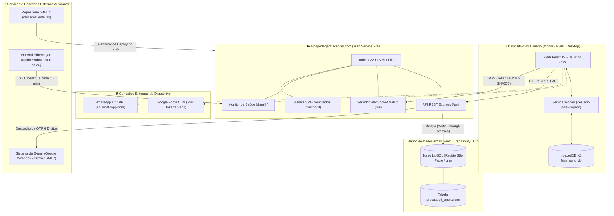

# HOSPEDAGEM, BANCO DE DADOS E CONEXÕES — CESTAON ("No CestaON, o preço é bom.")

> **MANDATO PERMANENTE: 100% GRATUITO (CUSTO ZERO PERPÉTUO) & DESEMPENHO MÁXIMO**  
> Toda a infraestrutura, hospedagem, banco de dados e serviços auxiliares do CestaON foram rigorosamente selecionados e arquitetados para operar estritamente dentro de camadas 100% gratuitas perpétuas (*Free Tiers* sem expiração), sem necessidade de cartão de crédito e sem riscos de encerramento por período de testes (como instâncias de 30 dias que deletam bancos ou encerram serviços).

---

## 1. Tabela Consolidada de Infraestrutura e Conexões

| Conexão / Serviço | Provedor / Tecnologia | Protocolo / Porta | Modelo de Custo | Finalidade no CestaON |
| :--- | :--- | :--- | :--- | :--- |
| **Hospedagem Principal** | **Render.com** (Web Service) | HTTPS / 443 | Free Tier Perpétuo ($0 / mês) | Executa o monólito Node.js 22 LTS (API Express, WebSocket Server e SPA compilada). |
| **Banco de Dados em Nuvem** | **Turso** (LibSQL Cloud) | `libsql://` (HTTPS / WSS) | Starter Free Perpétuo ($0 / mês) | Persistência remota com 9 GB gratuitos, 1 bilhão de leituras/mês e dados eternos. |
| **Bot Anti-Hibernação** | **UptimeRobot** / **cron-job.org** | HTTPS (GET `/health` ou `/`) | Free Tier Perpétuo ($0 / mês) | Pings a cada 5 min para manter o Render acordado 24/7 sem cold start. |
| **E-mails Transacionais (Opção A)** | **Google Apps Script Webhook** | HTTPS / 443 | 100% Gratuito (Google) | Disparo via webhook HTTPS de códigos OTP de 6 dígitos sem bloqueio de porta. |
| **E-mails Transacionais (Opção B)** | **Brevo REST API** | HTTPS / 443 | Free Tier (300 envios/dia) | Alternativa via API REST oficial para envio de e-mails em nuvem. |
| **E-mails Transacionais (Opção C)** | **Gmail SMTP** (Nodemailer) | SMTP SSL / 465 | Free Tier (500 envios/dia) | Conexão SMTP direta utilizando Senha de Aplicativo Google (`seu-email@gmail.com`). |
| **Tempo Real (WebSockets)** | **Node.js `ws` Nativo** | WSS (WebSocket Seguro) | Nativo no Servidor ($0) | Colaboração familiar instantânea de compras na mesma feira. |
| **CDN de Tipografia** | **Google Fonts** | HTTPS / 443 | 100% Gratuito (Google) | Fonte oficial *Plus Jakarta Sans* com autorização em CSP e cache offline. |
| **Compartilhamento Externo** | **Link Direto WhatsApp (Click-to-Chat) & Web Share** | HTTPS / URLs Nativas | 100% Gratuito ($0) | Abertura do app do WhatsApp com mensagem de convite pronta (sem API corporativa paga). |
| **Integração CI/CD** | **GitHub Webhooks** | HTTPS / 443 | 100% Gratuito (GitHub) | Deploy automático no Render a cada `git push origin main`. |
| **Armazenamento Offline** | **IndexedDB v2** (`feira_sync_db`) | Local no Navegador | Nativo do Dispositivo ($0) | Modo Subsolo para funcionamento sem sinal de internet em supermercados. |
| **Banco Local de Dev/Test** | **SQLite Nativo** (`node:sqlite`) | Embutido no Node.js | Nativo do Node 22 ($0) | Banco local com WAL mode para desenvolvimento e 228 testes automatizados. |

---

## 2. Diagrama de Arquitetura e Fluxo de Conexões



---

## 3. Hospedagem Principal: Render.com (Web Service Free)

O CestaON opera em produção pública hospedado no **Render.com**:

- **Endereço Oficial:** [https://seu-app.onrender.com](https://seu-app.onrender.com)
- **Tipo de Serviço:** *Web Service* conteinerizado com Node.js 22 LTS Alpine.
- **Arquitetura Monolítica de Alta Performance:**
  - O mesmo processo Node.js atende as requisições da **API REST** (`/api`), o **servidor WebSocket nativo** (`/ws`), a checagem de integridade (`/health`) e serve os arquivos estáticos compilados do React 19 (`client/dist`).
- **Deploy Contínuo (CI/CD):**
  - Integração via Webhook com o repositório GitHub (`origin/main`).
  - O comando `npm run build` instala automaticamente as dependências de produção do servidor e as ferramentas do cliente Vite (`--include=dev`), gerando os bundles estáticos otimizados.
- **Custo e Limitações do Free Tier:**
  - **Custo:** R$ 0,00 perpétuo (sem necessidade de cartão de crédito).
  - **Disco Efêmero:** O sistema de arquivos local do Render é volátil e reinicializado a cada deploy ou reinício do contêiner. Por este motivo, **nenhum dado crítico é armazenado no disco local da nuvem** — todas as feiras, itens, usuários e históricos são mantidos de forma durável no Turso LibSQL Cloud.

---

## 4. Bot Anti-Hibernação / Keep-Alive (UptimeRobot / cron-job.org)

### 4.1. O Desafio da Hibernação no Plano Gratuito do Render
No plano gratuito do Render, se uma aplicação ficar **15 minutos consecutivos sem receber requisições HTTP externas**, o contêiner entra em suspensão automática (hibernação) para economia de energia. Quando um usuário tenta acessar um aplicativo hibernado, ocorre o chamado **Cold Start**, no qual o servidor leva de **30 a 50 segundos** para subir o processo Node.js.

### 4.2. Como o CestaON Resolve o Cold Start a Custo Zero ($0)
Para manter o servidor sempre quente, ágil e acordado 24 horas por dia, 7 dias por semana, utiliza-se um serviço externo de monitoramento gratuito que envia uma requisição leve em intervalos inferiores a 15 minutos (configurado a cada 5 minutos na página principal/saúde).

### 4.3. O Endpoint de Saúde (`/health` e `/api/health`)
O CestaON possui um manipulador de saúde de alta confiabilidade implementado em [server/index.js](./server/index.js) (`createHealthHandler`):
- **URLs de Monitoramento:**
  - `https://seu-app.onrender.com/health`
  - `https://seu-app.onrender.com/api/health`
- **Verificação Atômica Real:** O endpoint não se limita a responder "ok" de memória. Ele realiza um teste round-trip de escrita e leitura na tabela `processed_operations` contra o banco de dados ativo.
- **Resposta HTTP 200 (Sucesso):**
  ```json
  {
    "status": "ok",
    "service": "cestaon",
    "uptime": 86420,
    "timestamp": "2026-11-14T10:00:00.000Z",
    "database": "turso_libsql_cloud_synced",
    "cloud_database": "connected",
    "persistence_verified": true,
    "environment": "production"
  }
  ```

### 4.4. Passo a Passo para Configurar o Bot Gratuito

#### Opção 1: UptimeRobot (100% Gratuito Perpétuo — Recomendado)
1. Crie uma conta gratuita em [uptimerobot.com](https://uptimerobot.com) (suporta até 50 monitores gratuitos).
2. Clique em **Add New Monitor**.
3. Preencha as configurações:
   - **Monitor Type:** `HTTP(s)`
   - **Friendly Name:** `CestaON Anti-Sleep Keep-Alive`
   - **URL (or IP):** `https://seu-app.onrender.com/health`
   - **Monitoring Interval:** `10 minutes` (ou `5 minutes`)
4. Clique em **Create Monitor**.
5. *Resultado:* O UptimeRobot enviará um ping periódico automático. O Render nunca hiberna e o app responde instantaneamente aos usuários.

#### Opção 2: cron-job.org (100% Gratuito e Ilimitado)
1. Crie uma conta gratuita em [cron-job.org](https://cron-job.org).
2. Clique em **Create Cronjob**.
3. Configure:
   - **Title:** `CestaON Render Keep Alive`
   - **Address:** `https://seu-app.onrender.com/health`
   - **Schedule:** A cada 10 minutos (`*/10 * * * *`).
4. Salve o agendamento.

---

## 5. Banco de Dados em Nuvem: Turso LibSQL Cloud

O CestaON utiliza o **Turso LibSQL Cloud** como banco de dados principal de produção:

- **Site Oficial:** [turso.tech](https://turso.tech)
- **Tecnologia:** LibSQL (fork aberto do SQLite otimizado para a borda e nuvem de altíssima velocidade).
- **Vantagens do Plano Gratuito Perpétuo (Starter Free Tier):**
  - **9 GB de armazenamento gratuito** (espaço para dezenas de milhões de registros).
  - **Até 500 bancos de dados individuais** gratuitos.
  - **Até 1 bilhão de leituras mensais**.
  - **Sem prazo de expiração:** Diferente de bancos que apagam dados após 30 dias de inatividade, o Turso mantém as informações salvas perpetuamente.
  - **Região de Baixa Latência:** Possui datacenter em **São Paulo (`gru`)**, proporcionando tempos de resposta de 5 a 20 milissegundos para usuários no Brasil.
- **Replicação Transacional Write-Through:**
  - Implementada em [server/db/database.js](./server/db/database.js) através do cliente oficial `@libsql/client`.
  - Cada mutação de feira, item ou usuário é confirmada atômica e remotamente via `client.batch(batch, 'write')`.
  - Se a rede falhar, ocorre rollback no banco local, garantindo zero descompasso e zero dados fantasmas.

---

## 6. Conexões de Envio de E-mails Transacionais

O envio de e-mails no CestaON é gerenciado pelo módulo [server/services/emailService.js](./server/services/emailService.js), projetado para atender aos fluxos de confirmação de cadastro e recuperação de conta:

### 6.1. Finalidades dos E-mails Transacionais
1. **Confirmação de Cadastro:** Envio obrigatório de código numérico de 6 dígitos para validação do e-mail no primeiro acesso.
2. **Recuperação de Acesso:** Envio de código de 6 dígitos para redefinição segura de senha em caso de esquecimento.
3. **Regras de Segurança:** Cada código possui validade (TTL) estrita de **15 minutos**, teto de **5 tentativas incorretas** contra força bruta e invalidação atômica imediata após o primeiro uso.

### 6.2. Arquitetura Multicanal Resiliente (Contorno de Bloqueios de Nuvem)
Em planos gratuitos de hospedagem em nuvem (como o Render Free), as portas tradicionais de envio SMTP (25, 465 e 587) podem sofrer restrições de firewall de rede contra spam. Para garantir 100% de entregabilidade em qualquer cenário a custo zero, o CestaON conta com uma estratégia em 3 camadas:

```
┌─────────────────────────────────────────────────────────────┐
│ 1. Canal Primário: Google Apps Script Webhook (HTTPS 443)   │  --> Porta 443 liberada, sem risco de bloqueio
├─────────────────────────────────────────────────────────────┤
│ 2. Canal Alternativo: Brevo REST API (HTTPS 443)            │  --> Cota de 300 e-mails/dia gratuitos
├─────────────────────────────────────────────────────────────┤
│ 3. Fallback: Gmail SMTP via Nodemailer (Porta 465 SSL)      │  --> Conexão direta com conta oficial Google
└─────────────────────────────────────────────────────────────┘
```

1. **Canal Primário (Recomendado no Render Free): Google Apps Script Webhook (Porta 443 HTTPS)**
   - Utiliza um script simples publicado como Web App no Google Apps Script vinculado à conta `seu-email@gmail.com`.
   - Como a requisição sai pela porta **443 HTTPS**, não há nenhum bloqueio de firewall pelo Render.
   - Cota: **500 e-mails por dia** gratuitos.
   - Variável de ambiente: `GMAIL_WEBHOOK_URL`.

2. **Canal Secundário: Brevo REST API (Porta 443 HTTPS)**
   - API REST oficial da Brevo (antiga Sendinblue) enviando via HTTPS na porta 443.
   - Cota: **300 e-mails por dia** gratuitos perpétuos sem expiração.
   - Variável de ambiente: `BREVO_API_KEY`.

3. **Canal Terceário / Direto: Nodemailer com Gmail SMTP (Porta 465 SSL)**
   - Utiliza Nodemailer conectado a `smtp.gmail.com` na porta 465 com SSL/TLS ativo (`secure: true`).
   - Autenticação via Senha de Aplicativo de 16 caracteres gerada na conta Google.
   - Variáveis de ambiente: `GMAIL_APP_USER` e `GMAIL_APP_PASSWORD` (ou `EMAIL_USER` e `EMAIL_PASS`).

---

## 7. Conexão em Tempo Real: WebSockets Nativos (`wss://.../ws`)

A colaboração simultânea entre membros da família na mesma feira é realizada via WebSockets:

- **Endereço de Conexão:** `wss://cestaon.onrender.com/ws`
- **Módulos Responsáveis:**
  - Backend: [server/ws/socketManager.js](./server/ws/socketManager.js) utilizando o pacote nativo `ws`.
  - Frontend: [client/src/hooks/useWebSocket.js](./client/src/hooks/useWebSocket.js).
- **Recursos e Blindagens de Produção:**
  - **Autenticação Criptográfica por Sala:** O cliente deve enviar uma mensagem `JOIN_LIST` contendo o token HMAC-SHA256 da sessão. Clientes sem autorização na lista são rejeitados com código 4003.
  - **Mitigação de CSWSH (Cross-Site WebSocket Hijacking):** Validação estrita do cabeçalho `Origin` na abertura do socket contra o domínio autorizado de produção (`cestaon.onrender.com`).
  - **Evicção de Sessão Única por Dispositivo:** Conectar uma nova aba ou aparelho com a mesma conta desativa a sessão anterior com código de fechamento 4001, prevenindo conflitos de concorrência.
  - **Rate Limiting por Conexão:** Teto de mensagens por segundo contra ataques de flood (código 1008).
  - **Heartbeat & Resiliência:** Ciclos de `PING`/`PONG` a cada 30 segundos. O frontend utiliza reconexão automática com *Exponential Backoff* e *Jitter*, reconectando suavemente caso o servidor acorde de um cold start.

---

## 8. Conexão CDN Google Fonts & Resiliência PWA

O CestaON adota a tipografia moderna **Plus Jakarta Sans** para máxima legibilidade visual:

- **Domínios Conectados:**
  - `https://fonts.googleapis.com` (Folhas de estilo CSS)
  - `https://fonts.gstatic.com` (Arquivos binários das fontes WOFF2)
- **Autorização no Content Security Policy (CSP):**
  - Configurado em [server/index.js](./server/index.js) permitindo os domínios em `style-src`, `font-src` e `connect-src` (requisições de cache do Service Worker).
- **Operação Offline no Subsolo:**
  - O Service Worker ([client/public/sw.js](./client/public/sw.js)) aplica a estratégia *Stale-While-Revalidate* com cache local para requisições de fontes externas.
  - Caso o usuário entre no subsolo de um supermercado onde não há internet, o app continua renderizando com a fonte estilizada sem quebras de layout.

---

## 9. Conexões Externas do Frontend (Compartilhamento Familiar)

O CestaON oferece mecanismos rápidos de compartilhamento familiar sem depender de servidores terceiros pagos:

1. **Link Direto do WhatsApp (Click-to-Chat / `api.whatsapp.com/send`):**
   - **Zero Custo ($0) & Sem Conta Comercial:** **NÃO se trata da WhatsApp Business Cloud API paga da Meta**. É apenas o recurso universal e gratuito de link web do WhatsApp (conhecido como *Click to Chat* ou `wa.me`).
   - Ao clicar em "WhatsApp" no modal de compartilhamento, o navegador apenas abre a URL `https://api.whatsapp.com/send?text=...` contendo o nome da feira, código de 6 dígitos e link de acesso direto. O aplicativo do WhatsApp no celular do usuário é aberto com a mensagem já digitada, bastando escolher o familiar ou grupo para enviar.
2. **Web Share API Nativa (`navigator.share`):**
   - Quando suportada pelo smartphone (Android / iOS), aciona a folha nativa de compartilhamento do sistema operacional (Telegram, WhatsApp, SMS, e-mail).
3. **Fallback para Área de Transferência:**
   - Cópia segura do código de feira ou link de acesso via `navigator.clipboard.writeText` ou `document.execCommand('copy')` com confirmação táctil (haptics) e visual (`✓ Copiado!`).

---

## 10. Armazenamento Local no Dispositivo (Modo Subsolo)

Para garantir operação perfeita mesmo dentro de depósitos, câmaras frias e subsolos de hipermercados onde não há cobertura de celular (4G/5G/Wi-Fi):

- **Banco de Dados Local no Dispositivo:** **IndexedDB v2** (`feira_sync_db`).
  - Store `pending_mutations`: Fila FIFO durável de itens adicionados, editados ou marcados no carrinho enquanto offline.
  - Store `sync_conflicts`: Registro seguro de conflitos de autorização recebidos pelo Service Worker com o app fechado.
- **Orquestrador de Sincronização:** [client/src/utils/syncManager.js](./client/src/utils/syncManager.js) e [client/src/hooks/useSubsurfaceSync.js](./client/src/hooks/useSubsurfaceSync.js).
- **Auto-Drenagem Inteligente:** Assim que o aparelho recupera o sinal de rede ou restabelece o WebSocket, a fila é automaticamente drenada e enviada ao backend via `POST /api/lists/:id/items` com marcadores de idempotência (`X-Operation-Id`), impedindo duplicações.
- **Dead Letter Queue (DLQ):** Mutações que falham por mais de 5 tentativas consecutivas em erros de servidor 5xx são isoladas na fila para não bloquear as operações seguintes.

---

## 11. Resumo das Variáveis de Ambiente no Render.com

Para deploy em produção com todas as conexões ativas:

| Variável | Exemplo de Valor | Obrigatória? | Finalidade |
| :--- | :--- | :--- | :--- |
| `NODE_ENV` | `production` | Sim | Ativa otimizações de produção, blindagem estrita e validações no boot. |
| `PORT` | `10000` | Sim (padrão Render) | Porta interna de escuta do Express e WebSocket. |
| `LIBSQL_URL` | `libsql://cestaon-db-olucsdn.turso.io` | Sim | URL de conexão direta ao banco de dados Turso LibSQL Cloud. |
| `LIBSQL_AUTH_TOKEN` | `eyJhbGciOi...` | Sim | Token JWT sem expiração gerado via `turso db tokens create`. |
| `AUTH_SECRET` | *(string de 64 caracteres hex)* | Sim | Segredo criptográfico para assinatura de tokens de sessão HMAC-SHA256. |
| `CORS_ORIGIN` | `https://seu-app.onrender.com` | Sim | Bloqueia requisições cross-origin e CSWSH de sites não autorizados. |
| `TRUST_PROXY` | `true` | Sim | Permite que o Express identifique o IP real do cliente atrás do proxy do Render. |
| `GMAIL_WEBHOOK_URL` | `https://script.google.com/macros/s/.../exec` | Opcional (Recomendado) | Endpoint HTTPS para envio de e-mails via Google Webhook (porta 443). |
| `BREVO_API_KEY` | `xkeysib-...` | Opcional | Chave de API da Brevo para envio alternativo via HTTPS (porta 443). |
| `GMAIL_APP_USER` | `seu-email@gmail.com` | Opcional (se usar SMTP) | E-mail da conta Google para envio via SMTP Nodemailer. |
| `GMAIL_APP_PASSWORD` | *(16 letras da senha de app)* | Opcional (se usar SMTP) | Senha de aplicativo Google (gerada em Gerenciar Conta Google > Segurança). |

---

## 12. Comandos Operacionais

```bash
# 1. Executar a aplicação em desenvolvimento local
npm start

# 2. Executar a suíte completa de 228 testes automatizados
npm test

# 3. Validar a integridade do protocolo Map-First
node --test tests/map_integrity.test.js

# 4. Compilar o frontend React com o Vite para produção
npm run build:client
```
